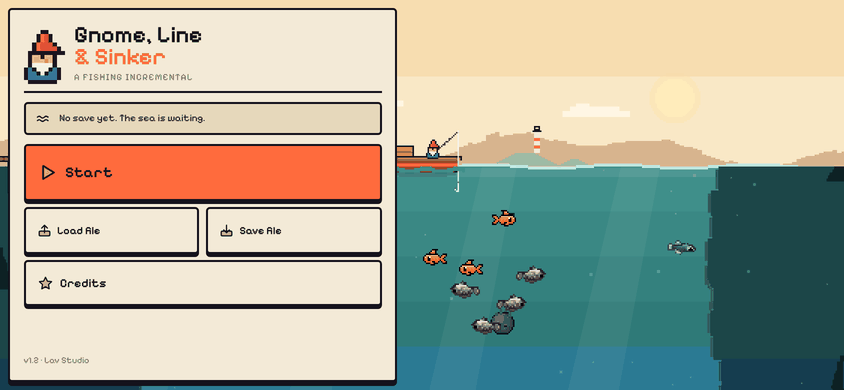
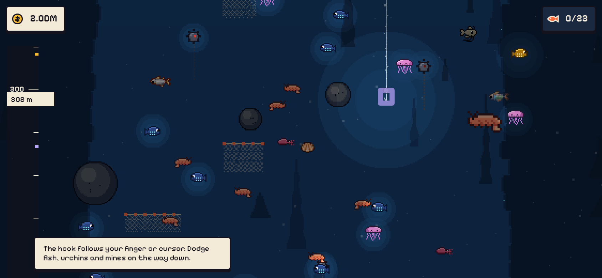
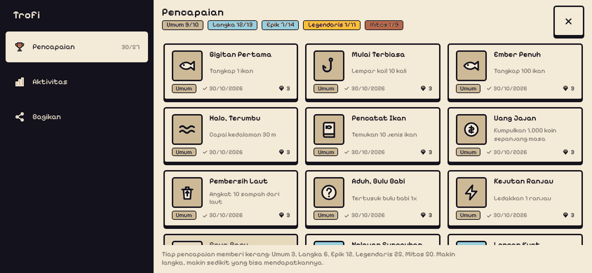
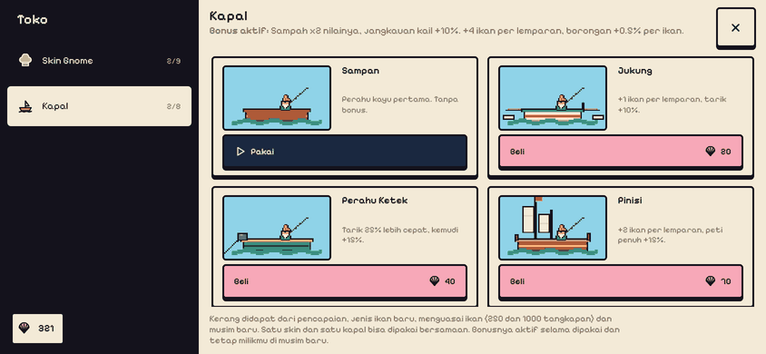
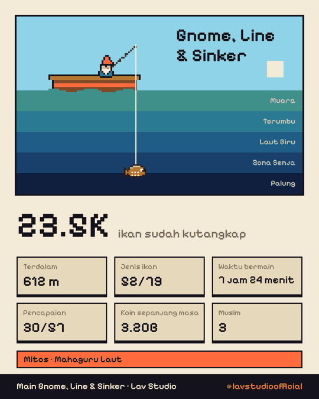
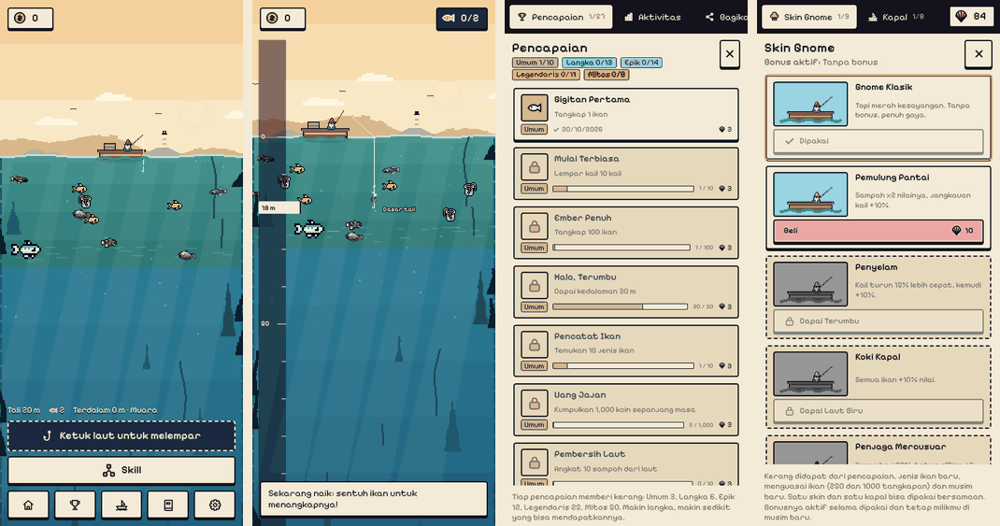

# Gnome, Line & Sinker

A chill fishing incremental game for landscape phones and desktop browsers. Tap the sea and the
gnome throws the hook there. Guide the lead weight down with your finger or cursor (the line
trails behind it like a snake), dodge fish, urchins, mines, ghost nets and currents, then catch
everything you touch on the way back up. Grow a 47-node skill tree from a muddy estuary to a sea
where goldfish have three eyes.










Plain HTML + JS, no build step, no dependencies, works offline.

## Play

Live: https://gnome.assamimuzaki.work/

```sh
python3 -m http.server 8124
# open http://localhost:8124/
```

(Opening `index.html` straight from disk also works in most browsers; a local server is safer
for fonts and the sprite sheet.)

Controls: tap the sea to cast. While the hook is underwater it chases your finger or cursor;
let go and it keeps sinking straight. Arrow keys / WASD work too, Space casts and collects.
On phones a joystick at the bottom steers the hook while casting, so your thumb does not cover
it (Settings > Controls switches back to touching the sea).

The start menu has Continue / New game, **Save to file** (downloads a `.sav` save) and
**Load from file**. Saves, in the file and in the browser, are scrambled with a keyed checksum
(`js/savecodec.js`), so an edited save is refused. Old plain browser saves still load once and are
re-saved encoded; old `.json` save files are no longer accepted. The same two buttons are in Settings.

## What is in it

- Obstacles: rocks to steer around, sea urchins and mines that end a dive (a mine on the way
  up knocks a fish off the hook), ghost nets that slow you, currents and bubble vents that push.
- 79 species in 6 depth zones (Estuary, Reef, Open Blue, Twilight, Trench, Weird Deep), 4
  mutations (Big, Golden, Prismatic, Titan), a Fishdex with mastery stars.
- Skill tree with six branches, mystery "?" nodes, pearl skills after the first new season.
- Fish pen idle income and capped offline earnings.
- Auto Angler skill that plays for you (the same bot the balance simulation uses).
- Generative lo-fi music and synthesized sound effects; the music muffles and darkens as the
  hook goes deeper.
- 57 achievements in five rarity tiers, a lifetime activity page, and a share card (image for
  Instagram and WhatsApp, or the phone's share sheet).
- Shop with 8 gnome outfits and 8 boats (sampan, jukung, pinisi, mini sub, ghost ship...),
  bought with shells from achievements; the one you wear gives a small perk.
- Plays in portrait or landscape (auto, or pinned in Settings), with a bottom bar and bottom
  sheets on phones held upright.
- Indonesian and English (follows the device language, switch in Settings).

## Files

| Path | What |
|---|---|
| `index.html`, `style.css` | shell, icon sprite, design system |
| `js/data.js` | zones, species, mutations, skill tree, tier costs |
| `js/engine.js` | pure game logic (no DOM): stats, tree, one cast, economy, seasons |
| `js/bot.js` | steering bot (Auto Angler, tests, balance) |
| `js/render.js` | canvas renderer |
| `js/ui.js`, `js/main.js` | interface and game flow |
| `js/trophies.js` | achievements, activity, share card, outfit and boat shop |
| `js/global.js`, `server/` | global counter (players and fish caught by everyone), Cloudflare Worker + D1 |
| `js/audio.js` | music, ambience and SFX (Web Audio) |
| `img/atlas.png`, `js/atlas.js` | sprite sheet, built by `tools/build_atlas.py` from `Assets/` |
| `docs/DESIGN.md` | research and design decisions |
| `docs/BALANCE.md` | pacing targets and simulation results |

## Checks

```sh
node scripts/test-engine.js          # engine tests
node scripts/check-no-emoji.js       # icons come from the SVG sprite, never emoji
node scripts/balance.js              # play a simulated timeline (skill 0.6, 6 h)
node scripts/balance.js --tune --write   # refit tier costs to the pacing targets
node scripts/smoke.js http://localhost:8124/ shots   # browser smoke test (Playwright)
```

Rebuild the sprite sheet after changing sprites: `python3 tools/build_atlas.py Assets`
(needs Pillow and numpy). `Assets/` is kept out of git and holds only the files the build reads:

```
Assets/
  pixel-gnome/             12 fish PNGs + Read Me.txt   (Pixel Gnome Fishing Pack sample)
  moranovo-fishing-icons/  Fishing Icons.png + Licence.txt + Fishing Icon List.txt
  free-fish/               free fish.png
```

## Credits

- **80+ Fishing Icons Asset Pack** by Moranovo: https://moranovo.itch.io/80fishing-icons-asset-pack
- **Pixel Gnome Fishing Pack** (free sample) by PixelGnome: https://pixelgnome.itch.io/fish
- Deep-sea fish, gnome, boat, obstacles, icons, UI, music and sound by Lav Studio.
- Font: Pixelify Sans (SIL Open Font License, `fonts/OFL.txt`).

The raw asset packs in `Assets/` are not redistributed with builds, only the packed sprite sheet.
